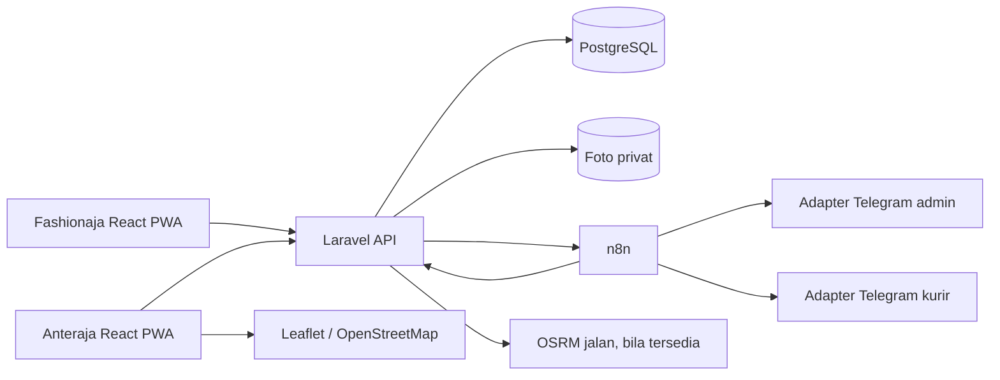

# Alur bisnis dan arsitektur

Dokumen ini menjelaskan hubungan dua aplikasi, satu backend, dan satu database. Lihat [PRD](PRD.md), [FRD](FRD.md), dan [ERD](ERD.md).

## Komponen

Fashionaja dan Anteraja adalah dua frontend yang dapat dibangun dan dideploy sendiri, tetapi keduanya memanggil Laravel yang sama. Frontend tidak menulis PostgreSQL langsung. Laravel adalah pemilik validasi, role, transaksi status, foto, dan outbox; n8n tidak mengubah shipment. Cookie/CSRF/CORS harus diatur untuk dua subdomain. Implementasi memakai sesi Laravel per tab agar pengguna dapat menguji role berbeda secara bersamaan.

## Dari checkout sampai hub

1. Buyer register/login dan checkout baju di Fashionaja. Server mengambil toko dan produk dari database, lalu menyimpan order `PENDING_APPROVAL` dengan snapshot penerima dan asal toko.
2. Ops admin menyetujui order. Laravel memilih hub dari cakupan kode pos tujuan, menetapkan hub yang sama sebagai hub asal/tujuan dalam alur MVP, lalu menerbitkan AWB dan pickup task. Banyak hub ada di master data; setiap paket hanya melewati satu hub.
3. Operator hub melihat tugas baru, memilih kurir pickup sesuai area/ketersediaan. Kurir menerima, mengambil foto baru, dan mengonfirmasi AWB. Operator menandai paket telah tiba di hub dengan tombol/nomor resi, tanpa perangkat pemindai.

## Last mile dan gagal kirim

1. Operator memilih paket siap antar, zona, tanggal/jam, dan kurir. Sistem memberi pratinjau urutan yang memperhatikan rute jalan, usia paket, retry, serta kelayakan area/kapasitas. Operator dapat meninjau sebelum membuat run.
2. Kurir menerima semua atau menerima/menolak paket tertentu dengan alasan. Penolakan kembali ke antrean operator; belum ada delivery attempt. Untuk paket yang diterima, operator mengonfirmasi serah terima fisik; kurir lalu mulai pengantaran.
3. Aplikasi kurir menampilkan peta segmen per stop. Di lokasi, kurir mencatat nama penerima dan foto kamera jika berhasil, atau alasan jika gagal. Server menyimpan satu attempt per hasil; bukti, aktor, waktu, dan status masuk ke riwayat.
4. Paket gagal masih bersama kurir sampai hub mengonfirmasi retur. Operator hub melihat kendala, berkomunikasi dengan pelanggan melalui kanal yang tersedia, dan memutuskan jadwal ulang/return. Pada reschedule, paket masuk antrean lagi, lalu dibuat run baru pada AWB yang sama.
5. Pelanggan mencari AWB di Anteraja. Pratinjau dan halaman detail terpisah; detail memuat timeline, attempt, bukti foto sesuai izin, serta konfirmasi penerimaan atau jadwal ulang pada status yang relevan. Fashionaja tetap hanya menampilkan pesanan dan nomor AWB.

## Notifikasi dan laporan

Laravel mencatat event serta notifikasi dalam database. n8n menerima webhook setelah commit dan menyapu antrean tertinggal; adapter MTProto memakai sesi akun pribadi admin atau kurir sesuai jenis pesan. Telegram LIVE dibatasi daftar email penerima; nomor telepon pelanggan dapat dipakai sebagai tujuan tanpa pairing terlebih dahulu, tetapi keberhasilan bergantung pada akun/privasi Telegram. Hanya hasil provider yang sah dicatat `SENT`; MOCK menjadi `SIMULATED`. Pelanggan tetap dapat melihat status di aplikasi ketika pesan gagal.

Laporan per hub/hari dapat disegarkan dari UI dan diekspor XLSX. `delivery_attempts` menyimpan banyak percobaan untuk satu AWB, sedangkan angka paket tidak digandakan. Foto berada di storage privat dan diakses melalui endpoint yang memeriksa hubungan user dengan shipment. Hub/zona/cakupan adalah data yang dapat ditambah, tetapi pemilihan hub saat ini memakai cakupan kode pos demo dan belum menangani transit antarahub.
