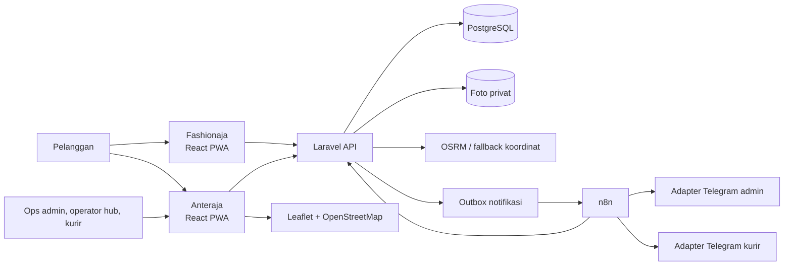

# Alur bisnis dan arsitektur

Dokumen ini menjelaskan aliran data yang sudah diterapkan. Kebutuhan produk ada di [PRD](PRD.md), perilaku per peran di [FRD](FRD.md), dan relasi data di [ERD](ERD.md).

## Aplikasi dan komponen

| Lapisan | Teknologi dan tanggung jawab |
| --- | --- |
| Fashionaja | React, TypeScript, Vite, Tailwind CSS, React Router, PWA; katalog baju, checkout, dan riwayat pesanan. |
| Anteraja | Stack frontend yang sama; pelacakan pelanggan serta antarmuka ops admin, operator hub, dan kurir. Leaflet/OpenStreetMap menampilkan hub, cakupan, dan perjalanan per stop. |
| Backend | Laravel API mengelola login, pemeriksaan role, validasi, transaksi status, perencanaan run, izin foto, riwayat, dan laporan XLSX. |
| Data | Satu PostgreSQL untuk kedua frontend. Foto berada di storage privat; database menyimpan referensi file. |
| Rute | OSRM memberi jarak/lintasan jalan bila tersedia; aplikasi memiliki fallback koordinat. Urutan paket juga memperhatikan usia paket dan prioritas antar ulang. |
| Otomasi | Laravel membuat notifikasi di outbox; empat workflow n8n menangani dispatch, pemulihan antrean, pengingat tugas, dan laporan harian. Adapter Telegram menggunakan sesi pengirim yang tersimpan privat. |

Kedua aplikasi dapat dipasang sebagai PWA dan dideploy terpisah: `katalog-fashionaja.rianyuliawan.my.id` dan `hackathon-anteraja.rianyuliawan.my.id`. Keduanya memanggil Laravel yang sama; frontend tidak mengakses PostgreSQL langsung. Sesi aplikasi disimpan per tab sehingga login role berbeda pada tab lain tidak menimpa sesi ini. Pemeriksaan hak akses tetap dilakukan server. Waktu aplikasi dan koneksi database menggunakan `Asia/Jakarta`, lalu ditampilkan sebagai WIB.

## Checkout sampai paket tiba di hub

1. Pembeli login atau mendaftar, memilih baju, lalu checkout di Fashionaja. Laravel menyimpan order dan item dengan snapshot produk, toko, nama, nomor telepon, dan alamat tujuan. Status awal `PENDING_APPROVAL`; belum ada AWB. `checkout_key` menjaga permintaan ulang agar tidak membuat order ganda.
2. Ops admin menyetujui order. Laravel memvalidasi berat, dimensi, dan cakupan kode pos, memilih hub/zona tujuan secara otomatis, menerbitkan AWB 14 digit, membuat shipment, parcel, tugas pickup, dan tracking event dalam satu transaksi. Persetujuan ulang tidak menerbitkan AWB baru. Fashionaja menampilkan AWB di detail pesanan tanpa membuka fitur tracking logistik.
3. Operator hub terpilih menugaskan kurir pickup yang sesuai area. Kurir menerima tugas, mengambil paket dari toko, dan mengambil foto baru lewat kamera. Operator hub mengonfirmasi paket fisik tiba melalui daftar atau pencarian AWB; scanner fisik tidak diperlukan.
4. Ada beberapa hub di master data Jakarta, tetapi satu shipment dalam alur saat ini dikoordinasikan oleh satu hub yang sama untuk pickup dan delivery. Transit antarahub belum menjadi langkah operasional aktif.

## Pengantaran, penolakan, dan gagal kirim

1. Operator hub memilih beberapa paket siap antar dalam zona yang sesuai, melihat usia paket dan rekomendasi urutan, menentukan kurir yang tersedia, lalu membuat satu run. Pemeriksaan server mencegah tugas aktif ganda dan kurir di luar cakupan/kapasitas.
2. Kurir menerima seluruh run atau menerima/menolak paket satu per satu. Penolakan paket wajib beralasan dan kembali ke antrean operator; penolakan sebelum berangkat **tidak** menambah nomor percobaan. Operator mengonfirmasi serah terima fisik untuk paket yang diterima.
3. Kurir memulai run. Peta menampilkan segmen hub ke stop pertama, lalu stop sebelumnya ke stop berikutnya. Di tiap alamat, kurir mencatat nama penerima dan foto kamera bila berhasil, atau alasan dan catatan bila gagal. Setiap kunjungan menghasilkan `delivery_attempts` serta event riwayat.
4. Paket gagal tetap dalam penguasaan kurir sampai operator hub mengonfirmasi pengembalian fisik. Operator hub kemudian mencatat tindak lanjut: jadwal ulang atau permintaan retur. Jika dijadwalkan ulang, paket masuk kembali ke antrean run dengan **AWB yang sama**; percobaan sebelumnya tetap tersimpan.
5. Pelanggan memasukkan hingga 10 AWB pada Anteraja. Hasil awal berupa kartu pratinjau yang seluruhnya dapat dibuka; detailnya menampilkan status, waktu WIB, nama kurir, alasan penolakan/gagal kirim, catatan, riwayat percobaan, dan foto yang diizinkan. Tombol perbarui status mengambil kondisi terkini tanpa menghapus AWB yang sedang dibuka.

| Tahap | Pemegang paket setelah tahap tersebut |
| --- | --- |
| Sebelum pickup | Toko/pengirim |
| Pickup berhasil dengan foto | Kurir pickup |
| Hub mengonfirmasi kedatangan | Hub |
| Operator menyerahkan run dan kurir mulai | Kurir delivery |
| Pengantaran gagal | Kurir delivery, hingga retur fisik dikonfirmasi hub |
| Pengantaran berhasil | Penerima |

## Notifikasi, audit, dan laporan

Laravel mencatat perubahan status, tracking event, dan outbox notifikasi. n8n mengirim pesan melalui adapter tanpa menjadi pengambil keputusan status shipment. Pesan LIVE hanya dinyatakan `SENT` setelah provider mengonfirmasi; mode MOCK berakhir `SIMULATED`, dan kegagalan provider dicatat `FAILED` tanpa membatalkan proses paket. Pembeli baru yang menyetujui notifikasi Telegram dapat dihubungi melalui nomor akunnya tanpa pairing/allowlist manual; akun seed tetap MOCK. Daftar email LIVE tetap tersedia untuk staf dan akun lama. Keberhasilan pengiriman bergantung pada akun dan pengaturan privasi Telegram penerima.

Ekspor workflow tersedia sebagai [dispatch notifikasi](../integrations/n8n/workflows/notification-dispatch.json), [pemulihan notifikasi](../integrations/n8n/workflows/pending-notifications.json), [pengingat tugas](../integrations/n8n/workflows/overdue-reminders.json), dan [laporan harian](../integrations/n8n/workflows/daily-report.json). Workflow laporan dijadwalkan pukul 17.00 WIB; dashboard operator hub juga menyediakan penyegaran manual dan unduhan XLSX. Kode Laravel tetap menjadi sumber angka laporan serta log status notifikasi.

Operator hub dapat menyegarkan ringkasan harian dan mengekspor XLSX berisi aktivitas serta percobaan. Ops admin dapat memantau ringkasan lintas hub. Tracking event dan delivery attempt tidak ditimpa. Koreksi waktu untuk event historis lama disimpan pada `tracking_event_time_corrections`; pembacaan tracking dan laporan memakai waktu efektif tersebut sementara baris audit asli tetap utuh.
