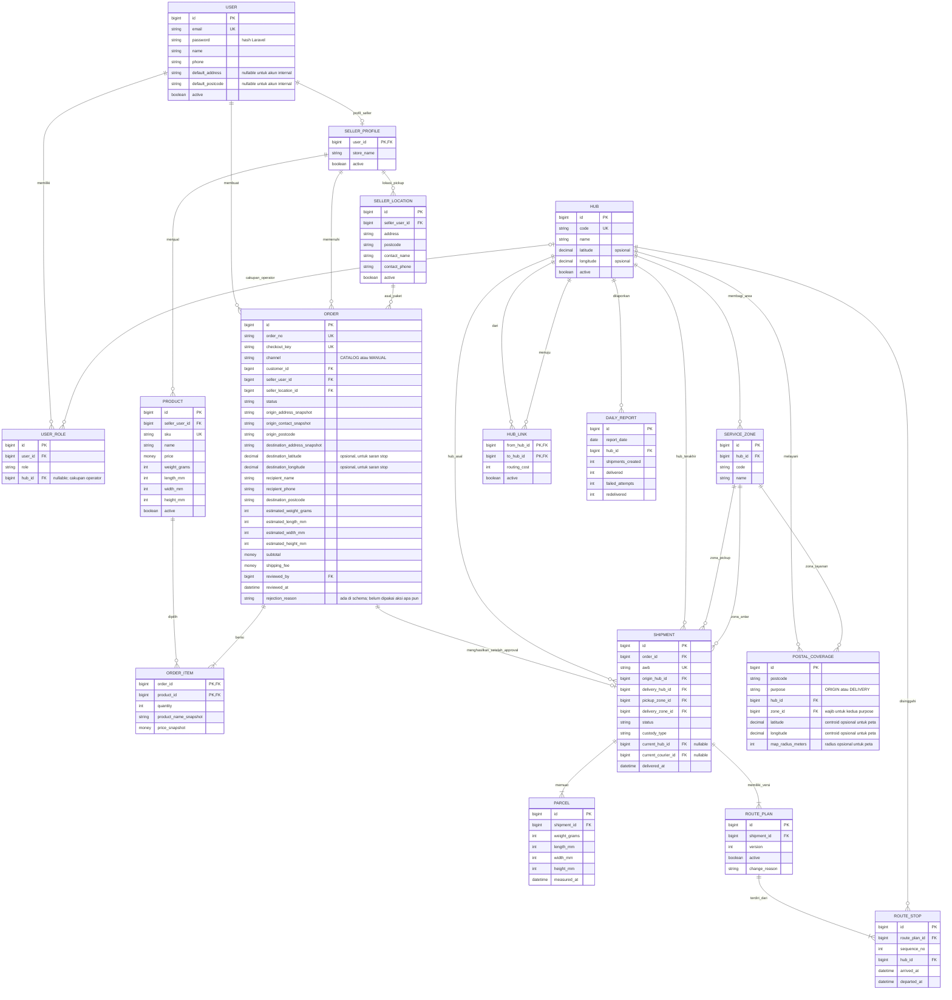
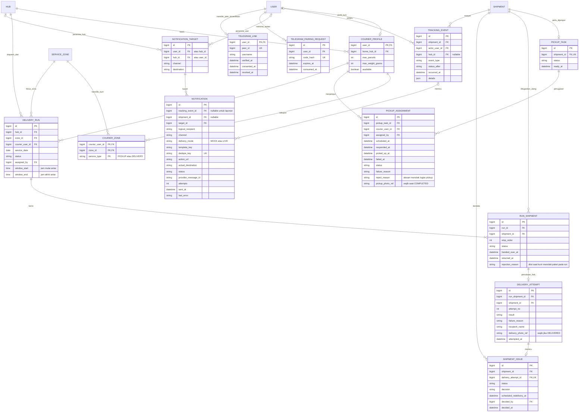

# ERD logis - Satria

ERD ini mengikuti [PRD](PRD.md), [FRD](FRD.md), dan [schema PostgreSQL](../backend/database/satria-schema.sql). Diagram dibagi dua agar relasinya terbaca; `USER`, `HUB`, `SERVICE_ZONE`, dan `SHIPMENT` yang muncul pada kedua diagram adalah **entitas yang sama**, bukan tabel duplikat. Diagram menonjolkan kunci dan relasi; daftar kolom serta constraint lengkap ada di schema. Katalog React dan web utama memakai database yang sama melalui Laravel API. Beberapa `HUB` dummy tersedia di DKI, tetapi setiap paket demo hanya mengunjungi **satu hub pengantaran**. `HUB_LINK` dan rute banyak stop adalah ruang ekspansi.

## 1. Toko baju, checkout, AWB, dan hub tujuan

**Makna penting:** satu toko baju/lokasi pickup serta produk dummy dibuat lewat seed, tanpa panel seller pada MVP. `USER` pembeli menyimpan profil default; `ORDER` menyimpan salinan nama/nomor/alamat tujuan ketika checkout agar histori tidak berubah jika profil diedit. `checkout_key` mencegah checkout ganda. Order sudah tersimpan sebagai `PENDING_APPROVAL` tanpa AWB; `SHIPMENT` baru muncul setelah ACC. `PARCEL` menyimpan berat/dimensi fisik. `POSTAL_COVERAGE` asal mengoordinasikan area pickup toko, sedangkan cakupan tujuan memilih **satu hub pengantaran** dari beberapa hub dummy. Demo membuat satu `ROUTE_PLAN` aktif dan satu `ROUTE_STOP` pada hub yang benar-benar menerima paket. `origin_hub_id` boleh berbeda dari `delivery_hub_id` karena pickup langsung membawa paket ke hub tujuan; hub asal tidak otomatis menjadi stop fisik.

## 2. Pickup, zona kurir, percobaan antar, dan notifikasi

**Makna penting:** satu `PICKUP_TASK` dibuat per shipment setelah ACC; `PICKUP_ASSIGNMENT` menyimpan kurir pickup. Penugasan yang ditolak/gagal tetap tersimpan. Hanya kurir pemilik tugas dapat menyelesaikan pickup dengan **foto di toko**. Satu `DELIVERY_RUN` milik satu kurir, satu tanggal/shift, dan satu zona antar. `RUN_SHIPMENT` menghubungkan banyak shipment ke run; shipment gagal dapat muncul lagi pada run berikutnya. `DELIVERY_ATTEMPT` dibuat saat kurir pemilik run melaporkan hasil; tugas yang ditolak bukan percobaan. Hasil `DELIVERED` mensyaratkan **foto serah terima**. Rujukan foto menunjuk file pada storage privat, bukan foto BLOB/URL publik. Gagal antar membuka `SHIPMENT_ISSUE` untuk keputusan admin setelah paket kembali dipindai di hub. Baris attempt dan event append-only. `TELEGRAM_PAIRING_REQUEST` menyimpan hash kode sekali pakai; `TELEGRAM_LINK` menyimpan identitas peer setelah buyer/internal mengirim kode dari akun Telegram dan memberi izin. Nomor HP order tidak dipakai sebagai peer otomatis. `NOTIFICATION` mencatat penerima logis, tujuan aktual, mode MOCK/LIVE, deduplikasi, serta hasil pengiriman. `DAILY_REPORT` menyimpan ringkasan per hub/hari.

## 3. Kardinalitas dan aturan data

| Relasi/aturan | Keputusan |
| --- | --- |
| `SELLER_PROFILE` → `PRODUCT`/`SELLER_LOCATION`/`ORDER` | Satu order hanya memakai produk dan satu lokasi milik seller yang sama; alamat pickup disalin ke order agar histori tidak berubah bila lokasi seller diedit. |
| Katalog React → `ORDER` | Katalog adalah frontend; `ORDER` dan `SHIPMENT` berada pada PostgreSQL milik Laravel. API riwayat menampilkan AWB setelah ACC tanpa database kedua. |
| `ORDER` → `SHIPMENT` | 1:0..1; order menunggu approval belum punya shipment/AWB. Satu order yang disetujui menghasilkan satu shipment. |
| `SHIPMENT` → `PARCEL` | 1:N secara model; demo memakai satu parcel per AWB. |
| `SHIPMENT` → `PICKUP_TASK` → `PICKUP_ASSIGNMENT` | Maksimal satu tugas pickup per shipment, tetapi bisa beberapa penugasan berurutan. Hanya satu penugasan yang boleh aktif; pickup sukses hanya sekali per AWB. |
| `SHIPMENT` → `ROUTE_PLAN` → `ROUTE_STOP` | Demo: satu versi aktif dan satu stop pada hub pengantaran. Hub koordinator pickup boleh berbeda dan tidak menjadi stop. |
| `POSTAL_COVERAGE` | Keunikan dijaga pada `(postcode, purpose, hub_id)`, sehingga satu kode pos boleh dilayani lebih dari satu hub. `ORIGIN` dipakai koordinasi pickup, `DELIVERY` memilih hub antar; zona harus berada di hub itu. Data demo memakai satu hub per kode pos. Tiap baris dapat menyimpan centroid dan radius untuk peta. |
| `COURIER_PROFILE` ↔ `SERVICE_ZONE` | M:N melalui `COURIER_ZONE`; `service_type` menentukan apakah kurir boleh pickup, antar, atau keduanya di zona itu. |
| `DELIVERY_RUN` → `RUN_SHIPMENT` | 1:N; semua item harus cocok dengan hub dan zona run. Satu shipment maksimal punya satu item penugasan yang masih aktif. |
| `SHIPMENT` → `DELIVERY_ATTEMPT` | 1:N melalui `RUN_SHIPMENT`. Nomor percobaan unik per shipment; hasil lama tidak ditimpa. |
| Foto pickup/delivery | `PICKUP_ASSIGNMENT.pickup_photo_ref` wajib saat COMPLETED; `DELIVERY_ATTEMPT.delivery_photo_ref` wajib saat DELIVERED. Foto gagal opsional. Laravel memverifikasi kurir login adalah pemilik assignment/run dan membatasi pembacaan file privat. |
| `DELIVERY_ATTEMPT` → `SHIPMENT_ISSUE` | Percobaan gagal dapat membuka satu kendala; admin mencatat keputusan dan jadwalnya pada kendala tersebut. |
| Gagal kirim dan custody | Sesudah gagal, `custody_type = COURIER`. Scan retur mengubahnya ke `HUB`; baru setelah itu dibuat penugasan ulang. |
| Pengembalian ke seller | Keputusan admin menghasilkan `RETURN_REQUESTED`; `RETURNED_TO_SELLER` baru setelah serah terima fisik. |
| Pickup dan custody | Sebelum pickup, `custody_type = SELLER`; foto/scan pickup memindahkannya ke `COURIER`; scan masuk **hub pengantaran terpilih** memindahkannya ke `HUB`. Hub lain tidak boleh menerima sebelum pickup sukses. |
| Konfirmasi pembeli | Dicatat sebagai `TRACKING_EVENT` baru pada shipment yang sudah `DELIVERED`; data percobaan kurir tidak diubah. |
| Telegram (rencana) | Tabel `TELEGRAM_PAIRING_REQUEST` dan `TELEGRAM_LINK` sudah ada, tetapi alurnya belum dijalankan: belum ada akun uji yang dipasangkan dan adapter MTProto belum aktif. Database aplikasi tidak menyimpan sesi Telegram. Nomor HP order bukan identitas tujuan Telegram. |
| Notifikasi | `dedupe_key` unik per event, penerima, dan template. Selama pengiriman belum aktif, catatan berakhir `SIMULATED`; `SENT` baru sah setelah adapter mengonfirmasi. Keputusan tugas kurir tetap di Laravel, bukan di n8n. |

Perhitungan jalur, pemeriksaan role, kapasitas kurir, kepemilikan produk oleh seller, dan transisi status tetap merupakan aturan Laravel. Schema menegakkan identitas unik, foreign key, kecocokan zona dengan hub, serta larangan penugasan aktif ganda. Laravel membuat event dan notifikasi bersama perubahan status dalam satu transaksi.
